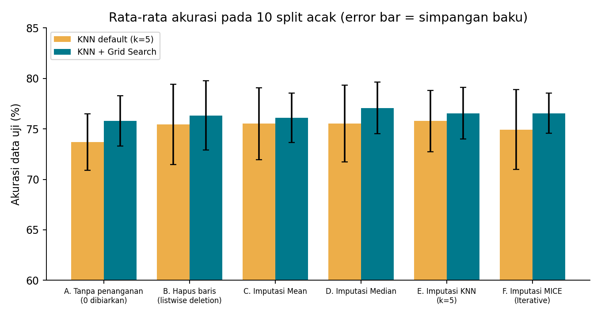

# Penanganan Missing Values pada Dataset Diabetes dengan KNN + Grid Search

> *Comparing missing-value handling strategies (drop, mean, median, KNN imputer, MICE) for a K-Nearest Neighbors classifier tuned with Grid Search, on the Pima Indians Diabetes dataset.*

Tugas kelompok mata kuliah **Pengantar Kecerdasan Buatan**. Repo ini membandingkan cara menangani *missing values* pada variabel **Glucose, BloodPressure, Insulin, dan BMI**, lalu mengukur pengaruhnya terhadap akurasi **KNN default** dan **KNN yang dioptimasi dengan Grid Search**.

## Anggota kelompok

| Nama             | NIM        | Kelas |
| ---------------- | ---------- | ----- |
| Adit Nurdiansyah | 3337250023 |   A   |
| Muhammad Awwab   | 3337250137 |   A   |
| Ibnu Zaki        | 3337250157 |   A   |

## Temuan utama

- *Missing value* pada dataset ini ditulis sebagai angka **0** (bukan kosong). Pada Insulin, 373 dari 767 baris (49%) terdampak.
- Akurasi **sebelum** penanganan: **73,70%** (KNN default) dan **75,78%** (KNN + Grid Search).
- Imputasi menaikkan akurasi sekitar **+1,2 sampai +2,1 poin** pada KNN default dan **+0,3 sampai +1,3 poin** pada KNN + Grid Search. Kenaikan ini **kecil dibanding fluktuasi antar-split** (simpangan baku sekitar 2–4 poin), dan setelah Grid Search belum terbukti signifikan.
- **F1-score kelas diabetes** naik lebih jelas (sekitar +3,5 sampai +4,7 poin), artinya imputasi membantu mendeteksi pasien diabetes.
- Menghapus baris yang bermasalah membuang 49% data dan hasilnya tidak stabil, jadi tidak disarankan.

## Hasil (rata-rata 10 split acak, data uji 20%)

| Skenario                           | Akurasi KNN default (%) | Akurasi KNN + Grid Search (%) | Perubahan vs A (poin) | F1 kelas diabetes (Grid Search) |
| ---------------------------------- | ----------------------- | ----------------------------- | --------------------- | ------------------------------- |
| A. Tanpa penanganan (0 dibiarkan)  | 73.70 ± 2.79           | 75.78 ± 2.49                 | –                    | 0.585                           |
| B. Hapus baris (listwise deletion) | 75.44 ± 3.97           | 76.33 ± 3.43                 | +0.55                 | 0.565                           |
| C. Imputasi Mean                   | 75.52 ± 3.56           | 76.10 ± 2.45                 | +0.32                 | 0.620                           |
| D. Imputasi Median                 | 75.52 ± 3.81           | 77.08 ± 2.54                 | +1.30                 | 0.626                           |
| E. Imputasi KNN (k=5)              | 75.78 ± 3.03           | 76.56 ± 2.55                 | +0.78                 | 0.632                           |
| F. Imputasi MICE (Iterative)       | 74.94 ± 3.95           | 76.56 ± 1.97                 | +0.78                 | 0.625                           |

*Skenario B memakai 392 baris (data lengkap saja), sehingga tidak sepenuhnya sebanding dengan skenario lain.*



Laporan lengkap (kajian pustaka, metodologi, pembahasan, dan keterbatasan) ada di folder [`reports/`](reports/).

## Struktur repo

```
knn-missing-values-diabetes/
├── README.md
├── requirements.txt
├── knn_missing_values.py      # program utama
├── data/
│   └── diabetes.csv           # dataset (Pima Indians Diabetes, 767 baris)
├── results/                   # output eksperimen (CSV + grafik)
└── report/
    ├── Laporan_Missing_Values_KNN.pdf
    └── Laporan_Missing_Values_KNN.docx
```

## Cara menjalankan

Butuh Python 3.10 atau lebih baru (diuji pada Python 3.12). Dari folder utama repo:

```bash
# (opsional) buat virtual environment
python -m venv .venv
.venv\Scripts\activate          # Windows
# source .venv/bin/activate     # Linux / macOS

pip install -r requirements.txt
python knn_missing_values.py
```

Di Windows, bila perintah `python` tidak mengarah ke instalasi yang benar, gunakan `py` (misalnya `py -m pip install -r requirements.txt` lalu `py knn_missing_values.py`).

Opsi yang tersedia:

| Opsi          | Fungsi                       | Default               |
| ------------- | ---------------------------- | --------------------- |
| `--csv`     | lokasi file dataset          | `data/diabetes.csv` |
| `--out`     | folder output hasil          | `results`           |
| `--repeats` | jumlah split acak (maks. 10) | `10`                |

Waktu eksekusi sekitar 5 menit untuk 10 split (sekitar 30 detik per split). Tidak ada tampilan sampai satu split selesai; itu normal. Gunakan `--repeats 1` untuk uji cepat.

## Metodologi singkat

- **Skenario:** (A) tanpa penanganan, (B) hapus baris, (C) imputasi mean, (D) median, (E) KNN Imputer (k=5), (F) MICE / Iterative Imputer.
- **Pipeline:** `StandardScaler → Imputer → KNN`, sehingga nilai pengganti hanya dipelajari dari data latih (tanpa *data leakage*).
- **Evaluasi:** split 80/20 stratified, diulang pada 10 seed acak (42–51); dilaporkan rata-rata ± simpangan baku.
- **Grid Search:** 5-fold CV pada data latih; k = 1, 3, …, 31; `weights` = uniform/distance; `metric` = euclidean/manhattan.
- **Metrik:** akurasi (utama) dan F1-score kelas diabetes.

## Keterbatasan

- Dataset kecil; simpangan baku antar-split lebih besar daripada sebagian besar selisih antar-metode.
- Ke-10 split saling tumpang tindih, sehingga uji statistik hanya bersifat indikatif.
- Kolom `SkinThickness` (227 nilai 0) tidak ditangani karena di luar instruksi tugas.
- Mekanisme *missing* (MCAR/MAR/MNAR) tidak dapat dibuktikan dari data ini.

## Referensi

- Batista, G. E. A. P. A., & Monard, M. C. (2003). An analysis of four missing data treatment methods for supervised learning. *Applied Artificial Intelligence, 17*(5-6), 519-533. https://doi.org/10.1080/713827181
- Jadhav, A., Pramod, D., & Ramanathan, K. (2019). Comparison of performance of data imputation methods for numeric dataset. *Applied Artificial Intelligence, 33*(10), 913-933. https://doi.org/10.1080/08839514.2019.1637138
- Little, R. J. A., & Rubin, D. B. (2019). *Statistical Analysis with Missing Data* (3rd ed.). Wiley. https://doi.org/10.1002/9781119482260
- Pedregosa, F., dkk. (2011). Scikit-learn: Machine learning in Python. *Journal of Machine Learning Research, 12*, 2825-2830. https://jmlr.org/papers/v12/pedregosa11a.html
- Rubin, D. B. (1976). Inference and missing data. *Biometrika, 63*(3), 581-592. https://doi.org/10.1093/biomet/63.3.581
- Smith, J. W., Everhart, J. E., Dickson, W. C., Knowler, W. C., & Johannes, R. S. (1988). Using the ADAP learning algorithm to forecast the onset of diabetes mellitus. *Proceedings of the Annual Symposium on Computer Application in Medical Care*, 261-265. https://pmc.ncbi.nlm.nih.gov/articles/PMC2245318
- Troyanskaya, O., dkk. (2001). Missing value estimation methods for DNA microarrays. *Bioinformatics, 17*(6), 520-525. https://doi.org/10.1093/bioinformatics/17.6.520
- van Buuren, S., & Groothuis-Oudshoorn, K. (2011). mice: Multivariate imputation by chained equations in R. *Journal of Statistical Software, 45*(3), 1-67. https://doi.org/10.18637/jss.v045.i03

## Sumber data

Pima Indians Diabetes Database (National Institute of Diabetes and Digestive and Kidney Diseases), tersedia di UCI Machine Learning Repository dan Kaggle. Berkas pada repo ini adalah salinan yang diberikan dosen untuk tugas (767 baris).
